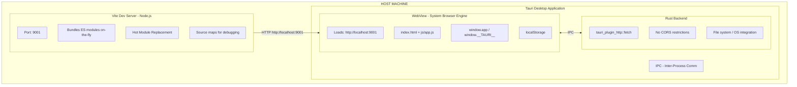
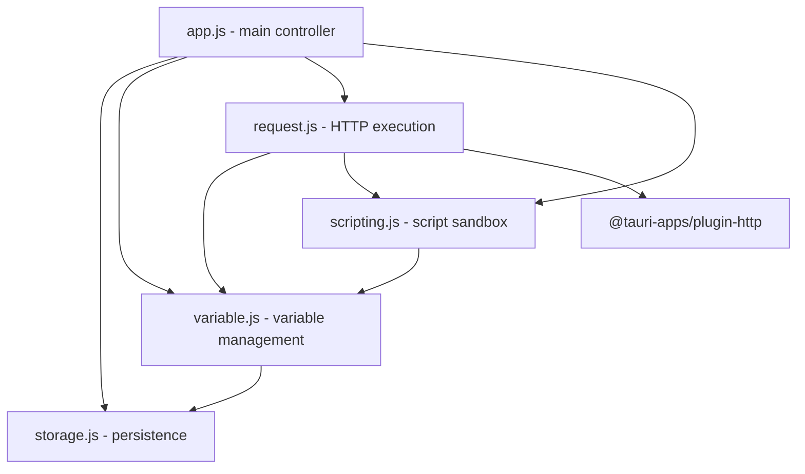
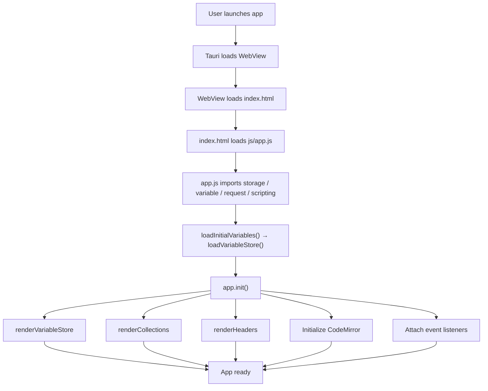
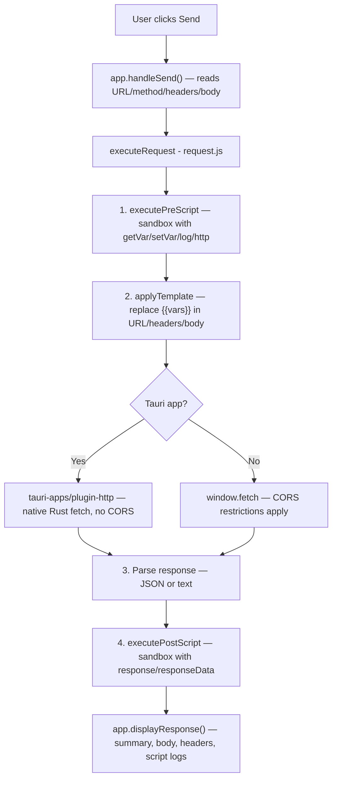
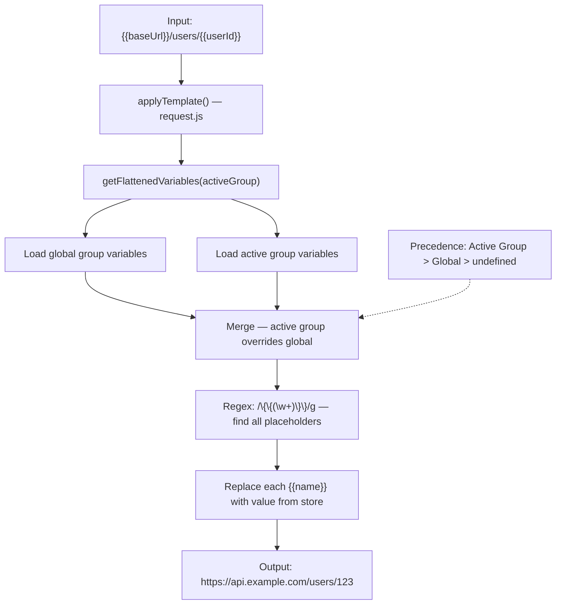

# Architecture Documentation

This document explains the technical architecture of Just REST Client, including how the frontend, backend, and build system work together.

## Table of Contents

- [Overview](#overview)
- [Technology Stack](#technology-stack)
- [Architecture Diagrams](#architecture-diagrams)
- [Module Structure](#module-structure)
- [Data Flow](#data-flow)
- [Development vs Production](#development-vs-production)
- [HTTP Request Flow](#http-request-flow)
- [Storage Architecture](#storage-architecture)

---

## Overview

Just REST Client is a hybrid desktop application built with:
- **Frontend**: Vanilla JavaScript (ES Modules), HTML, CSS with Tailwind
- **Bundler**: Vite (for ES module resolution and hot reload)
- **Backend**: Tauri (Rust-based native desktop framework)
- **WebView**: System WebView (Safari/WebKit on macOS)

The app combines web technologies for the UI with native Rust for backend functionality, resulting in a lightweight, fast, and CORS-free API client.

---

## Technology Stack

### Frontend
- **Language**: Vanilla JavaScript (ES6+ modules)
- **Styling**: Tailwind CSS (CDN in dev, can be optimized for production)
- **Code Editors**: CodeMirror 5 (JavaScript syntax highlighting)
- **Syntax Highlighting**: Prism.js (for JSON/response display)
- **Module System**: ES Modules (ESM)

### Build System
- **Bundler**: Vite 7.x
- **Dev Server**: Vite dev server (port 9001)
- **Module Resolution**: Vite handles `node_modules` imports

### Backend
- **Framework**: Tauri v2
- **Language**: Rust
- **Plugins**:
  - `tauri-plugin-http` - Native HTTP client (bypasses CORS)
  - `tauri-plugin-shell` - Shell command execution
- **WebView**: System-provided (no Chromium bundled)

### Storage
- **Client-side**: localStorage (JSON serialization)
- **Keys**: 
  - `restClient.variables` - Grouped variables: `{ groupName: { key: value } }`
  - `restClient.requests` - Saved requests with group field
  - `restClient.scripts` - Pre/post-request scripts with group field
  - `restClient.activeGroups` - Currently active group for each type
  - `restClient.groupNames` - List of all group names (including empty groups)

---

## Architecture Diagrams

### Development Mode Architecture



### Production Build Architecture

```mermaid
flowchart TD
    subgraph APP["Just REST Client.app — Single Binary (~6-11 MB)"] 
        subgraph WV[WebView - System Browser Engine]
            subgraph ASSETS[Bundled Web Assets]
                A1[index.html]
                A2["assets/index-hash.js — all modules bundled"]
                A3[assets/index-hash.css]
            end
        end
        IPC[IPC]
        subgraph RUST[Rust Backend - Compiled Binary]
            R1[Tauri runtime]
            R2[HTTP plugin - reqwest]
            R3[Shell plugin - statically linked]
        end
    end
    WV <-->|IPC| RUST
```

---

## Module Structure

### Frontend Module Organization

```
web/
├── index.html              # Main HTML entry point
├── css/
│   └── main.css           # Custom styles (supplementing Tailwind)
├── js/                    # ES Modules
│   ├── app.js             # Main controller & UI orchestration
│   │                      # - Group management UI
│   │                      # - Request/response display
│   │                      # - Event handling
│   ├── variable.js        # Variable store management (grouped)
│   │                      # - Global + active group scoping
│   │                      # - Flattened variable access
│   ├── storage.js         # localStorage persistence layer
│   │                      # - Group names persistence
│   │                      # - Active group tracking
│   ├── request.js         # HTTP request execution & templating
│   │                      # - Tauri HTTP plugin integration
│   │                      # - Variable templating
│   └── scripting.js       # Pre/post-request script engine
│                          # - Async script execution
│                          # - HTTP client for scripts
│                          # - getVar/setVar/log/http helpers
└── icons/                 # App icons

Key Design Patterns:
- ES Modules with explicit imports/exports
- Separation of concerns (storage, logic, UI)
- Functional programming style
- No frameworks - vanilla JavaScript
- Group-based organization for variables/requests/scripts
```

### Module Dependencies



### Backend Structure

```
src-tauri/
├── src/
│   └── main.rs            # Rust entry point
│       - Initializes Tauri
│       - Registers plugins
│       - Configures window
│
├── Cargo.toml             # Rust dependencies
│   - tauri = "2.x"
│   - tauri-plugin-http
│   - tauri-plugin-shell
│
├── tauri.conf.json        # Tauri configuration
│   - App metadata
│   - Build settings
│   - Window configuration
│   - Security policies
│
└── capabilities/
    └── default.json       # Permission definitions
        - HTTP scope (allowed URLs)
        - Window permissions
        - Core permissions
```

---

## Data Flow

### 1. Application Initialization Flow



### 2. Request Execution Flow



### 3. Variable Templating Flow



### 4. Storage Persistence Flow

```mermaid
flowchart TD
    subgraph VAR[Variables]
        V1["setVariable(key, value) — variable.js"]
        V2["variableStore[activeGroup][key] = value"]
        V3["saveVariableStore() — storage.js"]
        V4["localStorage: restClient.variables"]
        V1 --> V2 --> V3 --> V4
    end

    subgraph REQ[Requests]
        R1["saveRequest(obj) — storage.js"]
        R2[getAllRequests]
        R3[Find by ID or add new]
        R4["localStorage: restClient.requests"]
        R5["addGroupName('requests', group)"]
        R1 --> R2 --> R3 --> R4
        R3 --> R5
    end

    subgraph SCR[Scripts]
        S1["saveScript(obj) — storage.js"]
        S2["Same pattern as Requests"]
        S3["localStorage: restClient.scripts"]
        S1 --> S2 --> S3
    end

    subgraph GRP[Active Groups]
        G1["setActiveGroup(type, name)"]
        G2["activeGroups[type] = name"]
        G3["localStorage: restClient.activeGroups"]
        G1 --> G2 --> G3
    end
```



---

## Development vs Production

### Development Mode (`npm run dev` + `npm run tauri:dev`)

**Characteristics:**
- Vite dev server runs as separate Node.js process
- Fast hot module replacement (HMR)
- Source maps for debugging
- ES modules loaded on-demand
- Tauri connects to `http://localhost:9001`

**Workflow:**
```bash
Terminal 1: npm run dev
  → Vite starts on port 9001
  → Watches for file changes
  → Rebuilds modules on change

Terminal 2: npm run tauri:dev
  → Cargo compiles Rust (debug mode)
  → Launches Tauri window
  → Loads from localhost:9001
  → Hot reload when frontend changes
```

**Pros:**
- Instant feedback (< 1 second)
- Easy debugging with browser DevTools
- Source maps show original code

**Cons:**
- Requires two processes running
- Slightly slower initial startup

### Production Build (`npm run tauri:build`)

**Build Process:**
```
1. Vite Build Phase
   npm run build
     ↓
   Vite bundles all JS modules
     ├─→ Tree-shaking (remove unused code)
     ├─→ Minification
     ├─→ Asset optimization
     └─→ Output to dist/
   
2. Tauri Build Phase
   cargo tauri build
     ↓
   ├─→ Copy dist/ into app bundle
   ├─→ Compile Rust (release mode)
   │     - Full optimizations
   │     - Strip debug symbols
   │     - Link plugins statically
   ├─→ Create app bundle (.app on macOS)
   ├─→ Create installer (.dmg on macOS)
   └─→ Code signing (if configured)
```

**Output:**
```
src-tauri/target/release/bundle/
├── macos/
│   └── Just REST Client.app/
│       ├── Contents/
│       │   ├── MacOS/
│       │   │   └── just-rest-client  (5-10 MB binary)
│       │   ├── Resources/
│       │   │   ├── dist/  (bundled web files)
│       │   │   └── icons/
│       │   └── Info.plist
└── dmg/
    └── Just REST Client_*.dmg  (installer)
```

**Characteristics:**
- Self-contained (no dependencies)
- No Node.js runtime needed
- Pre-bundled JavaScript
- Optimized for size and speed
- Can be distributed to users

---

## HTTP Request Flow

### Tauri HTTP Plugin Integration

**Why the plugin is needed:**

Standard browser `fetch()` has CORS (Cross-Origin Resource Sharing) restrictions:
```javascript
// Browser fetch - CORS enforced
fetch('https://api.example.com/data')
  ❌ Blocked if server doesn't send CORS headers
  ❌ Preflight OPTIONS requests required
  ❌ Can't modify certain headers
```

Tauri's native HTTP plugin bypasses these:
```javascript
// Tauri fetch - No CORS!
import { fetch } from '@tauri-apps/plugin-http';
fetch('https://api.example.com/data')
  ✅ Works like curl - no CORS checks
  ✅ No preflight requests
  ✅ All headers allowed
  ✅ Better TLS/certificate handling
```

### Request Flow with Tauri HTTP Plugin

```
JavaScript Layer:
  import { fetch } from '@tauri-apps/plugin-http';
  const response = await fetch(url, options);
      ↓
  IPC (Inter-Process Communication)
      ↓
Rust Layer:
  tauri_plugin_http::fetch()
      ↓
  reqwest library (native HTTP client)
      ↓
  OS network stack
      ↓
  Internet → API Server
      ↓
  Response flows back up the chain
      ↓
JavaScript receives Response object
```

### Permission Model

Tauri uses a capability-based permission system:

**File:** `src-tauri/capabilities/default.json`
```json
{
  "identifier": "http:default",
  "allow": [
    { "url": "https://**" },      // All HTTPS
    { "url": "http://**" },       // All HTTP
    { "url": "http://localhost:*" },  // Localhost any port
    { "url": "http://127.0.0.1:*" }   // 127.0.0.1 any port
  ]
}
```

**How it works:**
1. JavaScript calls `fetch(url)`
2. Tauri intercepts the call
3. Checks if URL matches allowed patterns
4. If allowed → executes via Rust HTTP client
5. If denied → throws error

---

## Storage Architecture

### localStorage Schema

```javascript
// Key: 'restClient.variables' (grouped structure)
{
  "global": {
    "baseUrl": "https://api.example.com",
    "commonHeader": "application/json"
  },
  "production": {
    "apiKey": "prod_key_123",
    "token": "prod_token"
  },
  "dev": {
    "apiKey": "dev_key_456",
    "baseUrl": "http://localhost:8080"  // Overrides global
  }
}

// Key: 'restClient.requests'
[
  {
    "id": "req-1234567890",
    "title": "Get User Profile",
    "url": "{{baseUrl}}/users/{{userId}}",
    "method": "GET",
    "rawHeaders": [
      { "key": "Authorization", "value": "Bearer {{token}}" }
    ],
    "body": "",
    "preScriptId": "script-111",
    "postScriptId": "script-222",
    "group": "production"  // Group assignment
  },
  // ... more requests
]

// Key: 'restClient.scripts'
[
  {
    "id": "script-111",
    "name": "Get OAuth Token",
    "type": "pre-request",  // 'pre-request' or undefined (post-request)
    "code": "const response = await http('https://auth.api.com/token', {...}); setVar('token', response.data.access_token);",
    "group": "production"
  },
  {
    "id": "script-222",
    "name": "Parse User Data",
    "code": "if (responseData.user) { setVar('userName', responseData.user.name); }",
    "group": "global"
  },
  // ... more scripts
]

// Key: 'restClient.activeGroups'
{
  "variables": "production",
  "requests": "staging",
  "scripts": "global"
}

// Key: 'restClient.groupNames'
{
  "variables": ["global", "dev", "staging", "production"],
  "requests": ["global", "api-v1", "api-v2"],
  "scripts": ["global", "auth", "parsing"]
}
```

### Storage Operations

**CRUD Operations:**
```javascript
// Create
setVariable('key', 'value')  → localStorage.setItem()
saveRequest(request)         → push to array, save
saveScript(script)           → push to array, save

// Read
getVariableStore()           → localStorage.getItem() + JSON.parse()
getAllRequests()             → localStorage.getItem() + JSON.parse()
getAllScripts()              → localStorage.getItem() + JSON.parse()

// Update
setVariable('key', 'newValue')  → overwrite, save
saveRequest(existingRequest)    → find by ID, update, save
saveScript(existingScript)      → find by ID, update, save

// Delete
deleteVariable(key)          → delete from object, save
deleteRequest(id)            → filter array, save
deleteScript(id)             → filter array, save
```

### Export/Import

Users can export all data to a JSON file:
```json
{
  "metadata": {
    "version": "1.0",
    "exportedAt": "2024-01-15T10:30:00.000Z"
  },
  "variables": { ... },
  "requests": [ ... ],
  "scripts": [ ... ]
}
```

This allows:
- Backup/restore
- Sharing collections with team members
- Version control (commit to git)

---

## Security Considerations

### Script Execution Sandbox

Pre/post-request scripts run in a sandboxed environment with async support:

```javascript
// Sandboxing implementation (scripting.js)
const sandbox = new Function(
  'response',      // (post-script only) Response object
  'responseData',  // (post-script only) Parsed body
  'getVar',        // Read variables from store
  'setVar',        // Write variables to store
  'log',           // Output to script panel
  'http',          // Make HTTP requests
  `return (async () => { ${scriptCode} })();`  // Async wrapper
);

// Scripts have access to:
// ✅ response (Response object - read-only, post-scripts only)
// ✅ responseData (parsed JSON/text, post-scripts only)
// ✅ getVar(key) - read variables (with group scoping)
// ✅ setVar(key, value) - write variables (to active group)
// ✅ log(...args) - logging function
// ✅ http(url, options) - HTTP client (uses Tauri plugin if available)
// ✅ async/await - full Promise support
// ✅ Standard JavaScript (loops, conditionals, functions)

// Scripts DO NOT have access to:
// ❌ window object
// ❌ document object
// ❌ localStorage directly
// ❌ eval() or Function() constructor
// ❌ Direct Tauri APIs (only through http())
```

**Why this matters:**
- Prevents malicious scripts from accessing sensitive data
- HTTP requests go through controlled `http()` function
- Variables are read/written through controlled getVar/setVar
- Scripts can make network requests but with logging
- Async/await enables complex workflows (token refresh, chaining)

**Security Features:**
- Process isolation between WebView and Rust
- Script output is logged and visible
- HTTP calls are logged in script output
- Tauri HTTP permissions still apply (ACL controls allowed URLs)

### Tauri Security

- **Process Isolation**: WebView and Rust backend run in separate processes
- **IPC Validation**: All messages between JS and Rust are validated
- **Capability System**: Explicit permissions required for sensitive operations
- **CSP**: Content Security Policy can be configured
- **No eval() in Tauri APIs**: All commands are pre-defined in Rust

---

## Performance Characteristics

### Bundle Sizes

**Development:**
- Modules loaded on-demand
- Unminified code
- Full source maps
- ~2-3 MB total assets

**Production:**
- Bundled + minified JavaScript: ~200-500 KB
- CSS: ~50-100 KB
- Icons/images: ~100 KB
- Total web assets: < 1 MB
- Rust binary: 5-10 MB
- **Total app size: ~6-11 MB**

Compare to Electron (typical):
- Chromium + Node.js bundle: ~100 MB+
- App code: ~1-5 MB
- **Total: ~100-150 MB**

### Startup Time

- **Cold start**: ~0.5-1 second (depends on Mac)
- **Warm start**: ~0.2-0.5 second
- **Much faster than Electron** (no Chromium initialization)

### Memory Usage

- Typical idle: 50-80 MB
- With large response data: 100-150 MB
- **Electron equivalent: 200-400 MB**

---

## Future Enhancements

Potential architectural improvements:

1. **Web Worker for Scripts**
   - Move script execution to separate thread
   - Prevent UI blocking on long-running scripts

2. **IndexedDB for Large Data**
   - Replace localStorage for better performance
   - Support larger collections (> 5 MB)

3. **SQLite Plugin**
   - Native database for better queries
   - Tauri provides `tauri-plugin-sql`

4. **Streaming Responses**
   - Handle large file downloads
   - Progress tracking for uploads/downloads

5. **WebSocket Support**
   - Real-time API testing
   - GraphQL subscriptions

6. **OAuth2 Flow Handler**
   - Built-in OAuth redirect handling
   - Secure token management

---

## References

- [Tauri Documentation](https://v2.tauri.app/)
- [Vite Documentation](https://vitejs.dev/)
- [Tauri HTTP Plugin](https://v2.tauri.app/plugin/http-client/)
- [MDN: ES Modules](https://developer.mozilla.org/en-US/docs/Web/JavaScript/Guide/Modules)
- [Rust reqwest library](https://docs.rs/reqwest/)

---

**Document Version:** 1.0  
**Last Updated:** December 2024  
**Author:** Chester Kim

